<p align="center">
  
</p>

<h1 align="center">FloodSafe HK</h1>

<p align="center">
  <b>Walk Hong Kong safely in a rainstorm.</b><br>
  A live flood map checked by Gemini, plus walking routes that steer around the water.
</p>

<p align="center">
  <a href="https://floodsafe-hk-siir3lbvea-df.a.run.app"><b>▶ Open the live app</b></a> ·
  <a href="#-demo-video">Demo video</a> ·
  <a href="#-run-it-yourself">Run it yourself</a>
</p>

<p align="center">
  
  
  
  
</p>

> Built for the **Google Cloud AI Builder Cup 2026**, theme *Sustainability & Social Impact* (climate resilience).

---

## Why

In a Black Rainstorm, Hong Kong streets, underpasses and MTR exits can flood within minutes. In September 2023 more than 140 people were sent to hospital. Navigation apps still send pedestrians straight through knee-deep water because they don't know where it is, and official warnings cover whole districts, not individual streets.

FloodSafe HK gives people on foot the street-level picture. Neighbours report flooding, Gemini checks each photo, and the router keeps you dry.

<p align="center">
  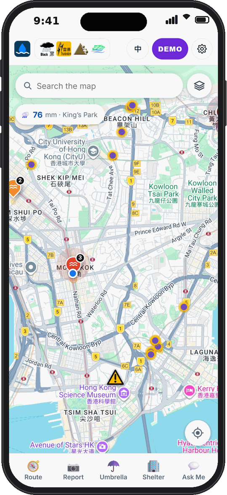
  &nbsp;
  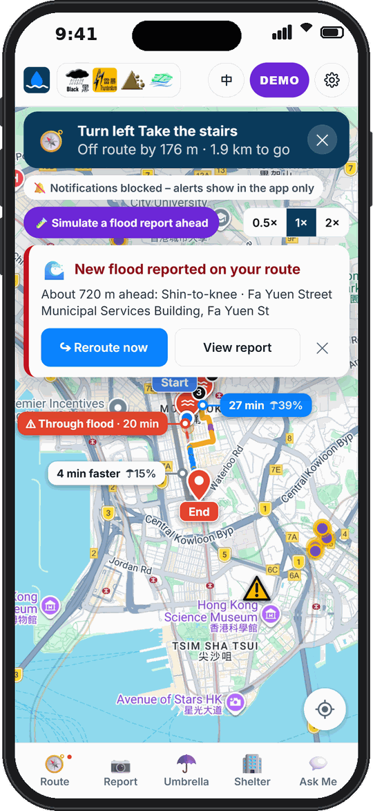
</p>

---

## Features

### 1. 🗺️ Live flood map
- **Official HKO warnings in the top bar.** These include the rainstorm signal (Amber, Red or Black), typhoon, thunderstorm and landslip warnings. Tap one to read the full Observatory text.
- **Crowd flood reports** appear as pins coloured by severity, from 0 (puddles) to 5 (above the waist or fast-flowing water). A report fades over time unless someone confirms it.
- **Official flood-prone spots** from the Drainage Services Department (DSD) switch on automatically when HKO raises a rainstorm signal. These cover flooding blackspots, underpasses, 231 roads prone to blockage, and drains. Routes are therefore flood-aware **before the first person reports anything**.
- **Map layers:** sheltered walkways from the Lands Department 3D Pedestrian Network (indoor, footbridge, covered, underground), HKO rainfall in the past hour by district, and umbrella-lending stations.
- **Tappable places,** as in Google Maps. Tap any shop, station or landmark for its details and a "Route here" button.
- **One-hand zoom.** Double-tap and hold, then slide down to zoom in or up to zoom out.

### 2. 🚶 Flood-aware walking routes

<table>
  <tr>
    <td width="33%">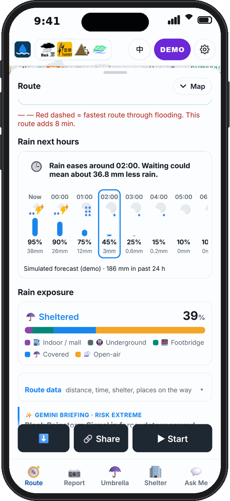</td>
    <td width="33%">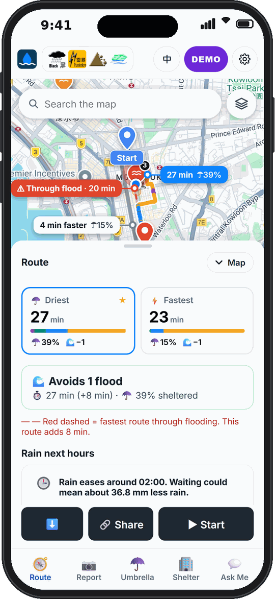</td>
    <td width="33%">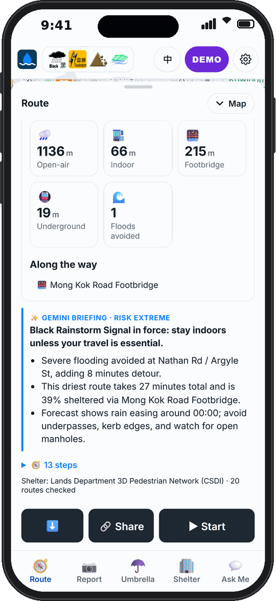</td>
  </tr>
  <tr>
    <td align="center"><sub>Pick a preference: Shortest, Balanced or Most covered</sub></td>
    <td align="center"><sub>Driest vs Fastest, with the time cost and % sheltered</sub></td>
    <td align="center"><sub>Gemini safety briefing and step-by-step directions</sub></td>
  </tr>
</table>

- Every Google walking route is **scored against live hazards**. If all of them cross flooding, FloodSafe adds detour waypoints around the blocked area. Ankle-deep water or worse blocks a route.
- **Stay-dry routing.** Routes are pulled through malls, footbridges and covered walkways using the LandsD 3D Pedestrian Network. Pedestrian subways next to a flood report count as flooded, because they fill first.
- **Comparing routes.** Up to three options are shown: *Driest*, *Balanced* and *Fastest*. Each one lists:
    - minutes and the % of the walk that is sheltered;
    - metres indoors, on footbridges, underground and in the open;
    - how many floods it avoids.

    The fastest route is drawn as a red dashed line when it goes through water.
- **"Rain next hours"** is a forecast from the Google Weather API along the trip, with advice on when to leave (for example "Rain eases around 00:00. Waiting could mean about 36.8 mm less rain").
- **Gemini route briefing** in English and Chinese. It is based only on the hazard data and the HKO signal, so it doesn't invent risks.
- **Walking only.** The app says so clearly and suggests public transport for longer trips.

### 3. 🧭 Turn-by-turn guidance with flood alerts
- Start a route for step-by-step instructions with a progress line, such as "Turn left. Take the stairs".
- If someone reports a flood **ahead on your route**, you get a push notification and an in-app alert with a **Reroute now** button.
- Demo mode simulates the walk at 0.5×, 1× or 2× speed, and has a **"Simulate a flood report ahead"** button for testing.

### 4. 📷 Report flooding with a photo, checked by Gemini

<table>
  <tr>
    <td width="25%">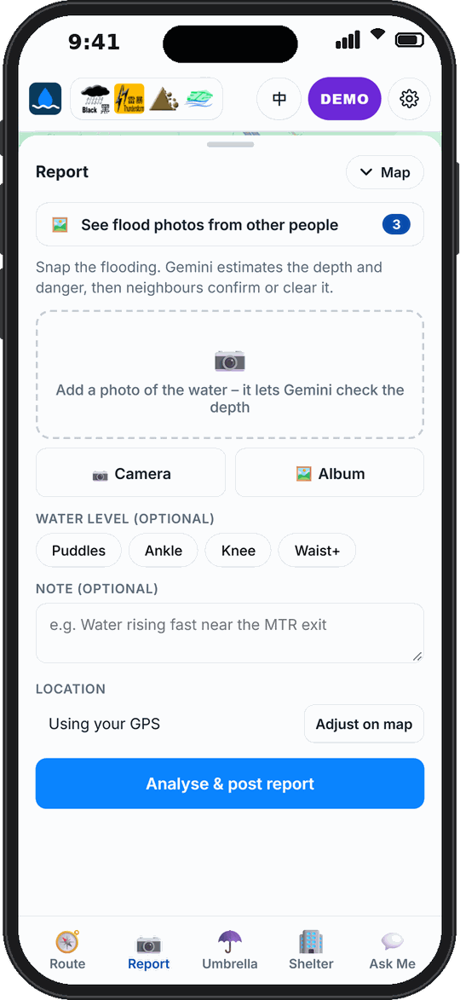</td>
    <td width="25%">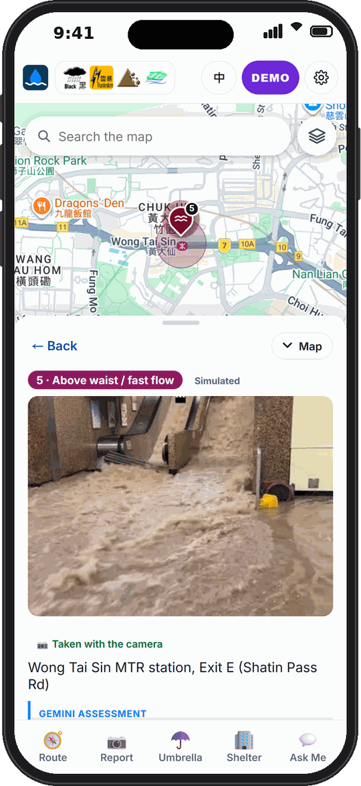</td>
    <td width="25%">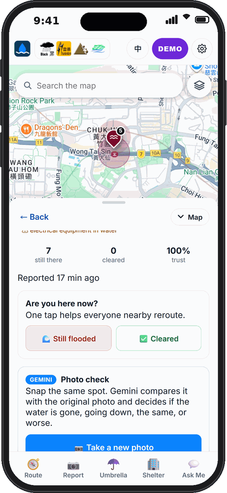</td>
    <td width="25%">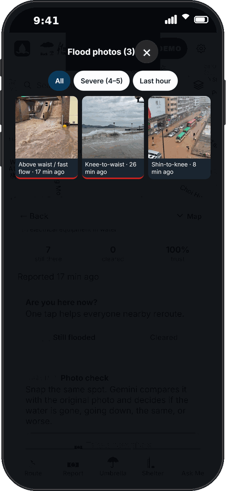</td>
  </tr>
  <tr>
    <td align="center"><sub>Snap or upload a photo</sub></td>
    <td align="center"><sub>Gemini rates depth and danger</sub></td>
    <td align="center"><sub>Neighbours confirm or clear it</sub></td>
    <td align="center"><sub>Browse all flood photos nearby</sub></td>
  </tr>
</table>

- **Gemini 3.5 Flash looks at the photo.** It does four things:
    - estimates depth from visual cues such as kerbs, wheels and knees;
    - rates severity from 0 to 5;
    - lists hazards (strong current, open manholes, debris);
    - writes an English and Chinese description.

    It also rejects photos that don't show flooding.
- **Waze-style verification.** Others tap **Still flooded** or **Cleared**, or take a new photo. Gemini **compares the new photo with the original** and judges the flood as cleared, receding, unchanged or worse. A trust score is kept for each report, and "worse" sends push alerts.
- **Photo wall and gallery.** Tap any report photo to view it full-screen. When there are 10 or more reports, they can be filtered (Severe 4–5, Last hour).
- Reports at an official DSD spot get a credibility boost, and Gemini is told the location's flood history.

### 5. ☂️ Umbrella lending

<table>
  <tr>
    <td width="33%">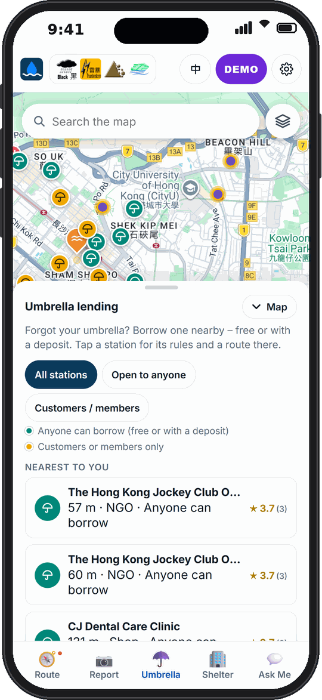</td>
    <td width="33%">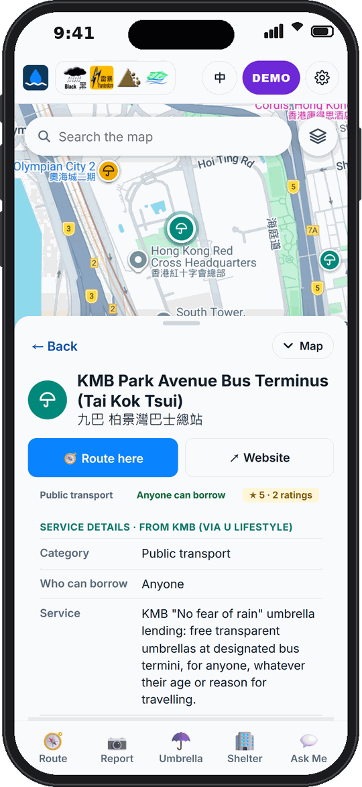</td>
  </tr>
  <tr>
    <td align="center"><sub>Nearest stations, filtered by who can borrow</sub></td>
    <td align="center"><sub>Rules, deposit, ratings, Route here</sub></td>
  </tr>
</table>

- A community map of places that lend umbrellas, including KMB bus termini, clinics, betting branches, gyms and NGOs. Filter by **Open to anyone** or **Customers / members**.
- Each station shows its rules and deposit, community ratings and reviews, and a one-tap route there.

### 6. 🏢 Shelter finder

<table>
  <tr>
    <td width="33%">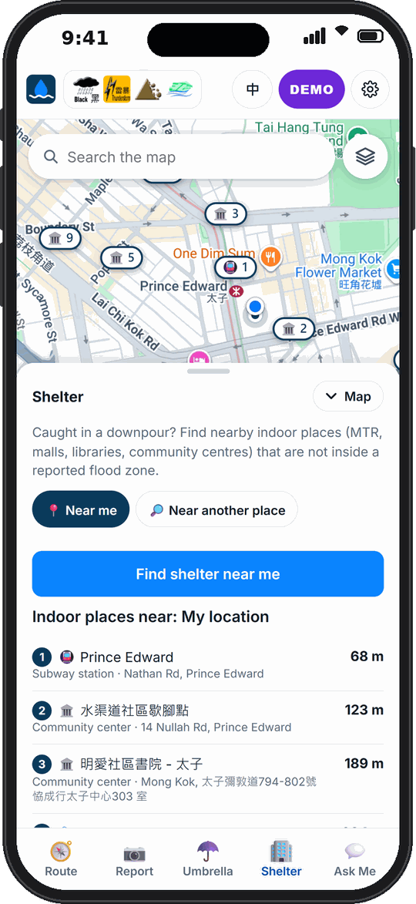</td>
    <td width="33%">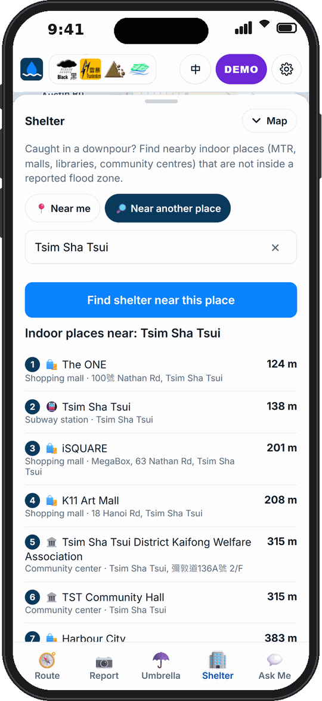</td>
  </tr>
  <tr>
    <td align="center"><sub>Near me: your live GPS position, numbered pins</sub></td>
    <td align="center"><sub>Near another place, e.g. Tsim Sha Tsui</sub></td>
  </tr>
</table>

- **Three ways to search:** **Near me** uses your live GPS position, never a guessed start point. **Near my destination** uses the trip's destination. **Near another place** lets you search any place in Hong Kong.
- **Real shelters only:** MTR and rail stations, big malls, libraries and community halls, within 1.2 km (3 km in quieter areas). Shops inside malls are filtered out.
- **Flood-aware:** places inside a reported flood are flagged and moved down the list. Tap one for a flood-safe walking route there.

### 7. 💬 Ask Me, a Gemini assistant

<table>
  <tr>
    <td width="33%">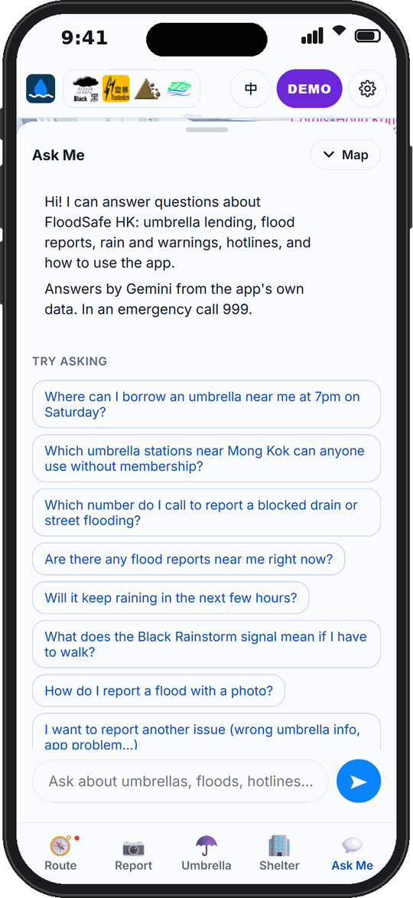</td>
    <td width="33%">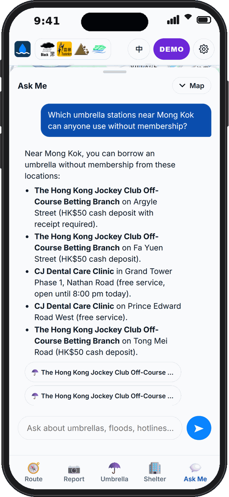</td>
  </tr>
  <tr>
    <td align="center"><sub>Suggested questions</sub></td>
    <td align="center"><sub>Answers grounded in the app's live data</sub></td>
  </tr>
</table>

- Ask questions like "Where can I borrow an umbrella near me at 7 pm on Saturday?", "Will it keep raining in the next few hours?" or "Which number do I call to report a blocked drain?"
- Gemini uses **function calling** on the app's own data: umbrella stations, weather, flood reports, flood-prone spots, verified government hotlines and feedback. It answers only questions about the app's topics. Places it mentions appear as tappable chips that open on the map.
- Hotlines are checked (999, 1823, DSD, Home Affairs, Social Welfare, CLP, HK Electric). There is a rate limit for each user.

### 8. 💾 Offline, share and settings

<p>
  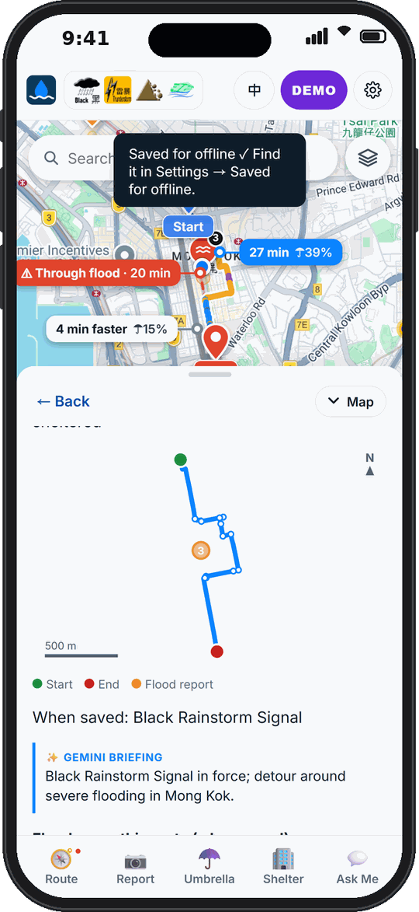
</p>

- **Save a route for offline use.** The route map, steps and Gemini briefing are kept on the phone, because signal often drops in a storm. Saved routes are listed under Settings → Saved, and you can also **download a GPX file**.
- **Share a route** with a link, so family can open the same safe route.
- **English / 繁體中文** switch instantly. This covers UI text, HKO warnings, place search, walking directions and Gemini's descriptions. The first visit follows the phone's language.
- **Light and dark mode.**
- An **installable PWA** with an app icon and offline start-up.
- **Demo mode** simulates a Black Rainstorm with sample flood reports, so you can try everything on a sunny day. Demo reports are visible only in your own session.

<br clear="right">

---

## 🎬 Demo video

<p align="center">
  <a href="https://youtu.be/780KkuOWIuU">
    
  </a>
</p>

<p align="center">▶ <b><a href="https://youtu.be/780KkuOWIuU">Watch the demo on YouTube</a></b></p>

---

## How it's built

```
Phone browser (PWA, Maps JavaScript API)
        │  HTTPS
        ▼
Cloud Run · asia-east2 (Hong Kong) · Node 22 / Express
   ├─ Gemini 3.5 Flash on Vertex AI ─ photo assessment, before/after check, briefings, Ask Me (function calling)
   ├─ Routes · Places (New) · Geocoding · Weather API  (server key in Secret Manager)
   ├─ Firestore ─ reports, votes, photos, shared routes, ratings
   ├─ Web Push ─ "flood ahead on your route" alerts
   └─ Open data ─ HKO warnings & rainfall · DSD flood-prone spots · LandsD 3D Pedestrian Network
```

| Google Cloud product | What it does here |
|---|---|
| **Gemini 3.5 Flash (Vertex AI)** | Multimodal flood assessment, before/after photo comparison, route briefings, the Ask Me assistant (structured JSON output and function calling) |
| **Cloud Run** | Hosts the web app and API in Hong Kong. Scales to zero, max 3 instances |
| **Cloud Build + Artifact Registry** | Build the container from source on every deploy |
| **Firestore** | Reports, votes, photos, shared routes, umbrella ratings |
| **Secret Manager** | Server-side Maps key. **No API key is ever sent to the browser** except the referrer-restricted Maps JS key |
| **Routes API** | Walking routes, alternatives and detour waypoints |
| **Maps JavaScript API, Places API (New), Geocoding API** | Map, search, place details, shelters |
| **Weather API** | Hour-by-hour rain forecast and past-24 h rainfall. Gives the "when to leave" advice and early flood flags |

**Open data:**
- **HKO Open Data API**: warnings (`warnsum`) and regional rainfall (`rhrread`).
- **DSD Flooding Blackspots**: the CSDI WFS feed.
- **DSD Locations Prone to Blockage**: `data/dsd_blockage.json`.
- **LandsD 3D Pedestrian Network**: the CSDI `PedestrianRoute` layer.

### Deployment on Google Cloud

<table>
  <tr>
    <td width="50%">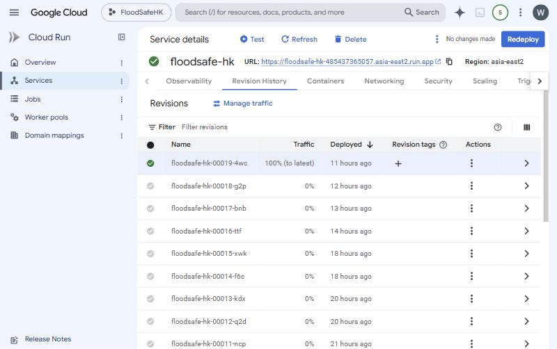</td>
    <td width="50%">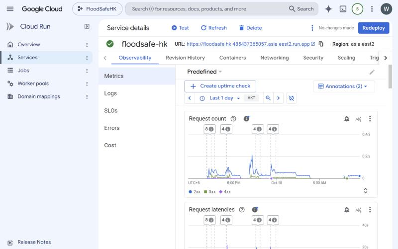</td>
  </tr>
  <tr>
    <td align="center"><sub>Cloud Run service <code>floodsafe-hk</code>, revision history</sub></td>
    <td align="center"><sub>Live request metrics</sub></td>
  </tr>
</table>

`deploy.ps1` (Windows) or `deploy.sh` does the whole deploy:
1. Enables the APIs.
2. Creates Firestore.
3. Gives the runtime service account only the roles it needs (Vertex AI user, Datastore user, Secret accessor).
4. Stores the Maps server key in Secret Manager.
5. Runs `gcloud run deploy --source .`, so **Cloud Build** builds the Dockerfile, **Artifact Registry** stores the image, and **Cloud Run** serves it.

---

## 🛠 Run it yourself

```bash
npm install
cp .env.example .env      # add your keys – .env is git-ignored, never commit it
npm run dev               # http://localhost:8080
```
It runs even without keys: storage is in memory, there's a fallback in place of Gemini, and routing is off. For Gemini you can use an AI Studio key locally, or Vertex AI with `gcloud auth application-default login`.

**Deploy to Cloud Run**
```powershell
gcloud auth login
gcloud config set project YOUR_PROJECT
powershell -ExecutionPolicy Bypass -File deploy.ps1     # add -SkipSetup to just redeploy
```
On Cloud Run, Gemini runs through Vertex AI with the service account, so no Gemini API key is needed.

**API keys** (Cloud Console → Google Maps Platform → Credentials)
- *Server key*, restricted to Routes, Places (New), Geocoding and Weather. It is stored in Secret Manager by the deploy script.
- *Browser key*, restricted to the Maps JavaScript API and Places API (New), with HTTP referrers set to your Cloud Run URL and `localhost:8080`.

### Project layout
```
server.js            Express API + static hosting
src/gemini.js        Gemini client, flood photo assessment, before/after check, briefing
src/chat.js          Ask Me assistant (function calling, hotlines)
src/routing.js       Flood-aware + stay-dry route scoring and detours
src/hko.js  dsd.js  gweather.js  shelter.js  places.js  push.js  store.js
public/              PWA front end (app.js, i18n.js, styles.css, sw.js)
scripts/             Data prep (DSD geocoding, umbrella stations)
deploy.ps1 / deploy.sh / Dockerfile
```

---

## Roadmap
- Gemini Live voice guidance for hands-free walking.
- Flood history in BigQuery, giving hotspot analytics for DSD and district councils.
- HKO gridded rainfall nowcast through Pub/Sub and Cloud Scheduler, as prior risk.
- The same engine for other monsoon cities: Shenzhen, Manila, Bangkok, Jakarta, Mumbai.

## Acknowledgements
Data: Hong Kong Observatory, Drainage Services Department and Lands Department (via CSDI), and public umbrella-lending programmes.
The idea of weather-aware walking routes was inspired by CoolMap (coolmap.tw).
